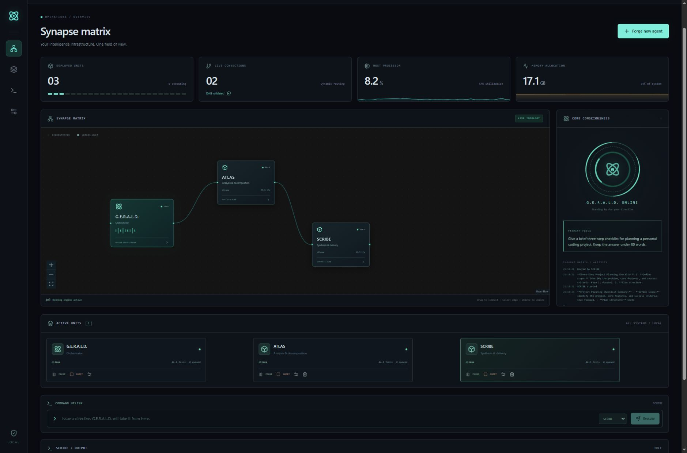
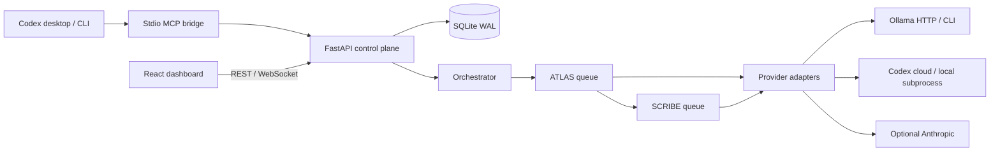

# G.E.R.A.L.D.

Global Execution, Routing, and Agent Lifecycle Director. A locally hosted workflow control plane with a React command deck, FastAPI runtime, persistent SQLite routing, streaming Ollama inference, and Codex desktop/CLI integration through MCP.



## Dashboard readability

The dashboard uses locally available Segoe UI/system fonts, 16px body text and form controls, and 13–15px metadata at default browser settings. Typography uses relative units so browser text preferences and zoom remain effective. Buttons have at least 44px targets, panels reflow on narrow windows, and the topology starts at a readable zoom with pan/zoom controls. No external font downloads are required. After pulling a UI update, run `npm run build` in `frontend` (or rerun `scripts/setup.ps1`) and reload the dashboard to load the new assets.

## Repository contents

### Private business launch desk

The **Business launch** tab displays a locally configured business identity, contact/signup email, honest mailbox/support capability status and downloadable launch documents. Setup and bounded local specialty-agent preparation are described in [BUSINESS-LAUNCH.md](BUSINESS-LAUNCH.md). Business data stays in ignored `data/workspace/business-launch/`; this repository does not contain a real contact list, Gmail credentials or autonomous email transport. Master plans now fail closed instead of broadcasting invalid plans to every connected worker.

For a shorter document path, configure the optional absolute `GERALD_BUSINESS_DOCS` directory in `.env`. The dashboard then serves business guides from that folder, and agents with `business_docs_read` receive bounded, read-only excerpts. Runtime settings, ledgers and credentials remain in `data/`; repository guides stay in Git. See [document relocation](BUSINESS-LAUNCH.md#keep-documents-in-a-convenient-folder).

### QwenW specialists and model selection

The six QwenW profiles are now available through the **QwenW toolbox** (wrench icon), with a shared project canvas, coder architecture-review gate and draft-only outreach. GERALD remains the runtime; the QwenW prototype engine is not used. For installation, file locations, workflow and safeguards, see [QWENW.md](QWENW.md).

Each worker's configuration now has a real **Model** dropdown: installed Ollama models for its selected server, or the locally cached Codex cloud catalogue. Select **Codex · Cloud sign-in**, choose a model, save, then enable **Cloud Apex mode** to use your CLI's existing ChatGPT/Codex subscription sign-in. Plan/workspace limits still apply; subscription access is not general-purpose API credit. GERALD reads `codex login status`, never copies authentication tokens. See [official authentication guidance](https://learn.chatgpt.com/docs/auth).

The repository includes the complete backend, frontend source, dependency manifests and lockfiles, launcher scripts, tests, CI workflow, and verification reports. Installed dependencies (`.venv`, `node_modules`), compiled UI assets, runtime databases, agent workspace files, logs, and local environment files stay on the workstation and are ignored by Git. On another machine, run `scripts/setup.ps1` to install dependencies and build the dashboard, select an installed Ollama model, and run `scripts/connect-codex.ps1` to register that checkout's MCP bridge.

## Dependencies and prerequisites

The supplied setup and launcher scripts target **Windows with PowerShell**. The original workstation was verified with Python 3.12.14, Node.js 24.22.0, Ollama 0.40.6, and Codex CLI 0.163.0. Those are the tested versions, not a requirement to install those exact releases.

| Dependency | Requirement | Purpose |
| --- | --- | --- |
| Python | 3.12+ with `venv` and `pip`; 3.12 is the tested baseline | Backend, workers, MCP bridge and tests |
| Node.js and npm | Node.js 22+ with npm | Install and compile the React dashboard |
| Git | Available on `PATH` | Clone and update this private repository |
| PowerShell | Available on Windows | Run setup and launcher scripts |
| Ollama | Running locally, with at least one downloaded model | Local inference and cloud-to-local fallback |
| Codex CLI | Optional for Ollama-only use; required for Codex workers and bridge registration | Cloud/local Codex execution and MCP configuration |
| Codex desktop app | Optional | Control GERALD through the desktop app's MCP tools |
| GitHub account access | Permission to clone `KSGhost13/gerald` | This repository is private |

Choose a local model that fits your machine's available memory. GERALD uses the models already installed in Ollama; setup does not download any models automatically. SQLite is included with Python, so no separate database server is needed. The compiled dashboard needs no internet access to fetch fonts, scripts or CDN assets.

### Python packages

`scripts/setup.ps1` installs these packages into the project's `.venv` using [backend/requirements.txt](backend/requirements.txt). The root [requirements.txt](requirements.txt) includes that same manifest.

| Package | Declared version | Purpose |
| --- | --- | --- |
| `fastapi` | `>=0.115,<1` | REST API and WebSocket endpoints |
| `uvicorn[standard]` | `>=0.34,<1` | ASGI server and protocol support |
| `httpx` | `>=0.28,<1` | Provider HTTP clients and API verification |
| `psutil` | `>=6,<8` | Host/process telemetry and process cleanup |
| `pywin32` | `>=308`, Windows only | Windows Job Objects for worker lifecycle containment |
| `pydantic` | `>=2.10,<3` | Request and agent configuration validation |
| `python-dotenv` | `>=1,<2` | Load local `.env` configuration |
| `mcp` | `>=1.12,<2` | Codex MCP bridge and protocol verification |
| `pytest` | `>=8,<10` | Backend test runner |
| `pytest-asyncio` | `>=0.25,<2` | Async lifecycle/routing tests |

[backend/requirements-lock.txt](backend/requirements-lock.txt) records the full installed Windows Python environment, including transitive dependencies. Normal setup uses the portable version ranges above; the Windows snapshot is a record of the original verified installation.

### Frontend packages

Versions are declared in [frontend/package.json](frontend/package.json); `npm ci` installs the exact dependency tree in [frontend/package-lock.json](frontend/package-lock.json).

| Package(s) | Declared version | Purpose |
| --- | --- | --- |
| `react`, `react-dom` | `^19.0.0` | Dashboard rendering |
| `@xyflow/react` | `^12.9.0` | Interactive workflow graph |
| `framer-motion` | `^12.23.0` | UI animation |
| `lucide-react` | `^0.468.0` | Interface icons |
| `vite` | `^6.4.0` | Development server and production build |
| `typescript` | `^5.9.0` | Type checking |
| `@vitejs/plugin-react` | `^4.7.0` | React integration for Vite |
| `tailwindcss`, `@tailwindcss/postcss` | `^4.3.3` | Tailwind styling and PostCSS adapter |
| `postcss` | `^8.5.0` | CSS build pipeline |
| `autoprefixer` | `^10.4.0` | Declared CSS tooling dependency |
| `@types/react`, `@types/react-dom` | `^19.0.0` | React TypeScript definitions |

## Setup guide: fresh Windows installation

### 1. Install prerequisites and clone the repository

Install Python, Node.js (including npm), Git, and Ollama, then open a new PowerShell window so their commands are available on `PATH`. Check them:

```powershell
python --version
node --version
npm --version
git --version
ollama --version
```

Clone using a GitHub account with access to this private repository:

```powershell
git clone https://github.com/KSGhost13/gerald.git
Set-Location gerald
```

If Python is available through the Windows `py` launcher rather than `python`, create the environment explicitly before running setup:

```powershell
py -3.12 -m venv .venv
```

### 2. Start Ollama and choose a model

Open the Ollama application, then list the models already installed:

```powershell
ollama list
```

If no Ollama server is running, start one in a **separate** PowerShell window with `ollama serve` and leave it running. Do not start a second server if the Ollama app already owns port 11434.

You can use an existing local model. To download the coding model used to verify the Codex local adapter:

```powershell
ollama pull qwen2.5-coder:14b
```

This download is optional if you already have a suitable model. Confirm server connectivity:

```powershell
Invoke-RestMethod http://127.0.0.1:11434/api/tags
```

### 3. Configure your local environment

Create `.env` without replacing an existing configuration, then edit it:

```powershell
if (-not (Test-Path .env)) { Copy-Item .env.example .env }
notepad .env
```

Set the default models to names shown by `ollama list`. For example, if you downloaded Qwen above:

```dotenv
GERALD_OLLAMA_URLS=http://127.0.0.1:11434
GERALD_LOCAL_MODEL=qwen2.5-coder:14b
GERALD_CODEX_LOCAL_MODEL=qwen2.5-coder:14b
GERALD_TASK_TIMEOUT=180
```

The supplied `.env.example` uses `ornith-1.5:9b` for HTTP workers because that model was installed on the original workstation. **Change that default on a new machine unless that model is installed there.** Choose a tool-capable model for Codex local workers; `qwen2.5-coder:14b` was verified for that path.

Leave `GERALD_CODEX_MODEL` empty to use the cloud Codex CLI default. `ANTHROPIC_API_KEY` and `GERALD_ANTHROPIC_MODEL` are optional and are only used when choosing the Anthropic provider. Local Ollama use does not require an API key. Keep credentials in `.env`, which Git ignores.

### 4. Install project dependencies and build the dashboard

From the repository root:

```powershell
.\scripts\setup.ps1
```

Setup creates `.venv` if necessary, runs `pip install -r backend/requirements.txt`, runs `npm ci` inside `frontend`, and compiles the UI with `npm run build`. It does not require activating the virtual environment.

If you prefer to perform those steps manually:

```powershell
python -m venv .venv
.\.venv\Scripts\python.exe -m pip install -r backend\requirements.txt
Push-Location frontend
npm ci
npm run build
Pop-Location
```

Skip the first manual command if `.venv` already exists. The build creates `frontend/dist`, which is intentionally not committed to Git.

### 5. Optional: connect Codex desktop and CLI

Skip this step for an Ollama-only dashboard. To enable Codex integration, install the CLI if needed:

```powershell
npm install -g @openai/codex
codex --version
```

For **cloud Codex workers**, sign in through the CLI and verify the session:

```powershell
codex login
codex login status
```

Local Codex workers use Ollama through `--oss --local-provider ollama`. To let the desktop app and CLI control the dashboard through MCP, register this checkout:

```powershell
.\scripts\connect-codex.ps1
codex mcp get gerald
```

Restart Codex after registration. Re-run registration if you move the checkout, because the MCP configuration stores absolute paths to this checkout's Python executable and bridge script. Keep the GERALD server running when using its MCP tools.

### 6. Start the dashboard

```powershell
.\scripts\start.ps1
```

Open **http://127.0.0.1:8765**. The backend serves the compiled UI, API and WebSocket stream from one origin. Leave the terminal open; **Ctrl+C** shuts down the foreground server and its workers.

For a hidden background instance instead:

```powershell
New-Item -ItemType Directory -Force data | Out-Null
.\scripts\start-background.ps1
```

Stop that managed background instance with:

```powershell
.\scripts\stop.ps1
```

Run only one instance on a given port. On the original workstation, a prepared background instance may already be running; open the URL before starting another one. Launcher scripts read a custom port from the **PowerShell environment**, so set `$env:GERALD_PORT='8766'` before launching if you need another port. Editing `GERALD_PORT` in `.env` alone does not change the port selected by these PowerShell launchers; the MCP bridge must also be configured to reach the chosen port.

### 7. Verify the installation and run your first mission

In another PowerShell window at the repository root:

```powershell
Invoke-RestMethod http://127.0.0.1:8765/api/health
Invoke-RestMethod http://127.0.0.1:8765/api/integrations
```

Health should report `status: online`. Integrations should show the Ollama server online and list your installed models. In the dashboard, keep **LOCAL FALLBACK MODE** selected, forge a worker using an installed Ollama model, and submit a short directive. A fresh checkout starts with GERALD only; the original workstation's workers, missions and SQLite database are not part of the repository.

To verify the MCP connection after registration:

```powershell
.\.venv\Scripts\python.exe scripts\verify-mcp.py
```

To check only local HTTP inference, without running the cloud verification:

```powershell
.\.venv\Scripts\python.exe scripts\verify-live.py ollama
```

The verification script submits a real generation request and updates `VERIFICATION.json`. Running it without provider arguments also checks Ollama CLI, Codex local and Codex cloud, so complete the optional Codex setup first if you want all four checks.

## Setup troubleshooting

| Symptom | Resolution |
| --- | --- |
| `python`, `npm`, `git`, `ollama` or `codex` is not recognized | Install the relevant prerequisite and reopen PowerShell. For Python, use `py -3.12 -m venv .venv` if the launcher is available. |
| PowerShell blocks an unsigned setup script | Use the manual setup commands above in a PowerShell session permitted by your device's policy. Virtual environment activation is not required. |
| Ollama connection fails | Open Ollama or run `ollama serve` in a separate terminal; check `GERALD_OLLAMA_URLS` and the `/api/tags` endpoint. |
| Model not found | Use the exact name from `ollama list`, download the chosen model if needed, and update `.env` or the worker's configuration. Restart GERALD after changing `.env`. |
| `frontend/dist/index.html` is missing | Run `scripts/setup.ps1`, or run `npm ci` and `npm run build` inside `frontend`. |
| Port 8765 already has a listener | Open the existing dashboard, or stop this project's background instance with `scripts/stop.ps1`; do not launch a duplicate instance. |
| Background launch fails on a completely fresh checkout | Create its log directory first with `New-Item -ItemType Directory -Force data`, or start once with `scripts/start.ps1`, which initializes runtime storage. |
| Codex MCP tools are absent or point to an old checkout | Re-run `scripts/connect-codex.ps1`, restart Codex, and verify with `codex mcp get gerald`. |
| Cloud Codex authentication fails | Run `codex login` and `codex login status`; local Ollama execution remains available. |
| A model runs out of memory or times out | Choose a smaller installed model or increase `GERALD_TASK_TIMEOUT` in `.env`, then restart. |

## File directory map

```text
gerald/
  .env.example                    All environment settings; no credentials included
  AGENTS.md                       Guidance for Codex working on this project
  README.md                       Setup, architecture and operating instructions
  VERIFICATION.json               Results from actual installed providers
  .github/workflows/ci.yml         Backend tests and frontend build
  backend/
    requirements.txt              Compatible dependency ranges
    requirements-lock.txt         Installed Windows Python dependency snapshot
    gerald/
      config.py                   Environment, server/model defaults and paths
      models.py                   Validated request schemas
      storage.py                  SQLite state and bounded event journal
      providers.py                Ollama HTTP/CLI, Codex cloud/local, Anthropic
      core.py                     BaseAgent, Orchestrator, queues, graph and lifecycle
      session.py                  Durable current-chat inbox, claims and responses
      main.py                     REST API, WebSocket telemetry, compiled UI hosting
      mcp_bridge.py               Thirteen stdio tools for Codex desktop and CLI
      qwenw.py                    Profile import, scoped canvas, artifact and draft safeguards
  frontend/
    package.json / package-lock.json
    vite.config.ts                Local development API/WebSocket proxy
    postcss.config.js             Tailwind 4 compilation
    src/
      main.tsx                    React entry
      api.ts                      Typed data and API client
      App.tsx                     Matrix, worker forge, activity, missions, integrations
      SessionBrain.tsx            Existing-chat link and pending directive status
      QwenLibrary.tsx             Imported profiles, shared canvas, human review and draft UI
      ModelPicker.tsx             Per-agent Ollama/Codex model dropdown and custom IDs
      session.css                 Current-chat panel styles
      style.css                   Obsidian/cyan/amber HUD, responsive layouts
    dist/                         Built dashboard, ready to serve
  scripts/
    setup.ps1                     Install dependencies and compile UI
    start.ps1                     Foreground localhost server; Ctrl+C shuts down workers
    start-background.ps1          Hidden background server with recorded PID
    stop.ps1                      Stop this project's managed background process tree
    connect-codex.ps1             Register stdio bridge in Codex
    verify-live.py                Real provider connectivity/generation checks
    verify-mcp.py                 Official MCP client protocol smoke test
    verify-workflow.py            Starter graph and real end-to-end mission test
    session-relay.py              Bind and operate this chat's inbox without an MCP reload
    import-qwenw.py               Preserve a local source snapshot and install six profiles
    verify-qwenw.py               Real Ollama/Codex subscription smoke test for the adapter
  packs/qwenw/                    Portable reviewed profiles and their content hashes
  tests/
    test_core.py                  Routing, cycle rejection, controls and fallback tests
    test_api.py                   API validation, origin checks and WebSocket test
    test_processes.py             Actual CLI parent/child cleanup and local policy tests
    test_session.py               Session pickup, routing, idempotency, abort and recovery
    test_qwenw.py                 Import, canvas scope, review gates, path safety and recovery
    test_discovery.py             Safe CLI sign-in status and model catalogue filtering
  data/                           Created locally; ignored by Git
    gerald.sqlite3                Agent specs, graph, mode, missions and event journal
    workspace/                    Worker input files and generated artifacts
    server*.log / server.pid      Managed background server diagnostics
  SESSION-BRAIN.md                 Heartbeat processing and existing-chat setup guide
```

## Use the dashboard

1. **Forge new agent**: set a designation, role, directive, provider and model. Local model choices are discovered from your configured Ollama servers. Each new worker is initially connected to GERALD.
2. **Issue a directive**: select GERALD to plan and distribute a goal, or select a worker for direct execution. The orchestration plan is an explicit task list; the activity terminal shows public decisions, task lifecycle and outputs.
3. **Route work visually**: drag from a source handle to a target handle. Reconnect an edge to redirect it; select an edge and press Delete/Backspace to unlink it. The backend commits graph changes atomically and rejects cycles. Current work uses the latest graph when it completes.
4. **Pause** lets the current generation finish, then holds new tasks. **Resume** releases the queue. **Abort** cancels current execution and discards that agent's queued tasks. Other agents already executing remain independent. **Delete** aborts and removes the worker and its edges.
5. **Configure** edits a worker's directive, provider and tool permissions. Changes apply to its next generation. Dragged positions persist across server restarts.
6. **Select an active unit** to inspect its output. The mission archive shows completion, failures and pending counts. Host CPU/RAM and real generation throughput stream over WebSocket.

## Execution paths

| Dashboard brain | Execution path | Credentials |
| --- | --- | --- |
| Ollama HTTP | Streaming `/api/chat` on a configured server | None for local models |
| Ollama CLI | `ollama run MODEL --hidethinking --nowordwrap --verbose` | None for local models |
| Codex cloud | `codex exec --json --ephemeral` | Existing `codex login` ChatGPT session |
| Codex local | `codex exec --oss --local-provider ollama --json` | None for local models |
| Current Codex chat | Durable inbox → in-thread heartbeat → public response / worker assignments | Existing Codex chat and a configured heartbeat |
| Anthropic | Streaming Messages API | Optional server-side `ANTHROPIC_API_KEY` |

Your existing Ollama models remain installed. The HTTP default is `ornith-1.5:9b`. The tested Codex local default is `qwen2.5-coder:14b`; imported Ornith models failed Codex tool-schema generation during verification. The local Codex adapter disables browser/image/multi-agent tool families for compatibility with Ollama's tool schema parser. Its shell/file execution remains available under Codex's sandbox.

**Local mode** redirects cloud agents to local Ollama, requires loopback server addresses, and substitutes the default local model for `:cloud` names. It controls GERALD's provider selection; it does not change the operating system firewall or independently configured Ollama server networking. **Cloud mode** allows the chosen cloud providers. If a Codex-cloud or Anthropic call fails, that task retries using local Ollama. Mode changes apply when a task starts, and do not migrate an in-flight generation.

To add an Ollama server, copy `.env.example` to `.env`, edit `GERALD_OLLAMA_URLS` (comma-separated addresses), and restart. Remote servers work in cloud mode. Do not commit `.env`. No API keys are sent to the frontend. OpenAI cloud generation is provided by the installed Codex CLI and existing sign-in, so a separate OpenAI API key is not required.

## Codex desktop and CLI integration

The installed bridge uses Codex's shared MCP configuration. Run `scripts/connect-codex.ps1` if you move the project. Restart Codex after registration or an MCP tool update, keep GERALD running, then use these tools:

| Tool | Purpose |
| --- | --- |
| `gerald_state` | Inspect workers, graph, missions, outputs and events |
| `gerald_integrations` | Discover configured Ollama servers and installed CLIs |
| `gerald_forge` | Create a worker with a directive, brain and tools |
| `gerald_mission` | Submit a goal to GERALD or a specific worker |
| `gerald_control` | Pause, resume, abort or delete a worker |
| `gerald_route` | Replace graph edges atomically |
| `gerald_mode` | Toggle local/cloud execution |
| `gerald_session_inbox` | Check UI directives addressed to the bound existing chat |
| `gerald_session_claim` | Claim a directive and read worker/routing context |
| `gerald_session_progress` | Publish public progress and renew the claim |
| `gerald_session_respond` | Return this chat's answer and optional worker assignments |

### Make your existing Codex chat the main brain

Ask Codex in the chat you want to use: “Bind this chat as GERALD's main brain and enable a heartbeat to process dashboard directives using SESSION-BRAIN.md.” This is separate from the `codex` provider, which starts a fresh CLI model process. The `codex-session` provider is reserved for GERALD itself and sends directives to the existing chat's durable inbox.

Once linked, the dashboard shows **CODEX SESSION / MAIN BRAIN** with that chat's title and ID. Select **G.E.R.A.L.D.** as the command target and enter a directive. The linked chat picks it up, can use its conversation history and tools, and posts its answer back to the output panel. It can answer directly or explicitly assign work to connected workers. Workers continue using their configured Ollama/cloud brains.

Automatic pickup uses an in-thread Codex heartbeat, approximately every minute while Codex is running and the chat can take a turn. It is **not instantaneous**; an active turn, approval or sleeping app can delay pickup. A manual Link chat action records the destination but does not create a heartbeat. The existing chat can use `scripts/session-relay.py` immediately; newly added MCP tools require Codex to reload the bridge. See [SESSION-BRAIN.md](SESSION-BRAIN.md) for setup, the complete processing protocol, and recovery behavior.

**Pause** holds pickup, **Abort** cancels queued/claimed directives, and **Use model brain** restores the previous master brain. Abort rejects late responses but cannot forcibly interrupt this independent Codex chat or undo actions already performed. The local/cloud toggle controls worker providers; the linked chat uses Codex's own selected model/network settings. To stop automatic inbox checks as well, pause or remove the chat's heartbeat in Codex.

Example instruction in a new Codex chat: “Use GERALD to inspect the agents, give ATLAS a short planning task, and report the resulting job status.” The bridge exposes the same local runtime to desktop and CLI; it does not scrape or modify unrelated desktop chats. Worker Codex subprocesses ignore the global user configuration to prevent recursive GERALD MCP invocation and accidental inheritance of unrelated plugins.

Verify registration and protocol:

```powershell
codex mcp get gerald
.\.venv\Scripts\python.exe scripts\verify-mcp.py
```

The implementation follows [Codex MCP documentation](https://developers.openai.com/codex/mcp), the installed `codex exec --help`, and [Ollama's Codex integration](https://docs.ollama.com/integrations/codex). Ollama streaming uses the [official chat API](https://docs.ollama.com/api/chat).

## Architecture and runtime behavior

Each BaseAgent owns a bounded asyncio queue and one worker task. The Orchestrator holds the mutable DAG, dispatches JSON task plans to directly connected workers, and forwards worker outputs down the latest edges. Invalid plans fall back to broadcasting the original goal to connected workers. Fan-out is supported; multiple upstream messages invoke a downstream agent independently rather than joining them into a single combined input. There is no autonomous infinite agent loop: the graph is acyclic and queues, output size and task duration are bounded.



Jobs count pending tasks across branches and become complete only after all scheduled work settles. A watchdog expires queued work, including paused queues, after `GERALD_TASK_TIMEOUT`. Provider calls have the same execution deadline. Mission history, specs, routing, node positions and public events persist in SQLite WAL. A server restart restores configuration and marks interrupted running missions; it does not replay unfinished tasks.

CLI workers run in Windows Job Objects with kill-on-close and explicit process tree cleanup on cancellation. HTTP workers cancel and close their streaming connections; the shared Ollama server is left running. A disconnected client cannot request additional work through that cancelled stream, but the server's handling of already submitted inference belongs to Ollama. The foreground launcher runs graceful FastAPI shutdown on Ctrl+C. The managed background stop script verifies the recorded PID's executable/command before terminating its tree.

HTTP agents share the backend process, so per-agent CPU/RAM attribution is unavailable. The HUD reports host metrics, actual CLI process RAM/CPU time where a PID exists, and provider generation throughput. Codex throughput is output tokens divided by end-to-end execution time; Ollama uses reported generation timing. The UI does not fabricate per-agent inference memory or GPU counters.

Utility permissions have concrete provider-specific behavior: `system_metrics` adds host telemetry to the task; `workspace_read` adds a bounded text snapshot for direct model providers; `workspace_write` saves their answer as a workspace artifact. Codex uses its built-in tools, with `workspace_write` selecting workspace-write instead of read-only sandboxing, and the workspace set as its working directory. Codex's sandbox policy controls its broader filesystem reads; these checkboxes do not provide a custom per-file OS isolation boundary. Model outputs are displayed as plain text.

This is a local single-user application, bound to loopback with Host and browser Origin validation. It has no multi-user authentication or remote exposure configuration. Local processes can access its API. Production deployment beyond this local operating model requires an explicit authentication and deployment design.

## API surface

`GET /api/health`, `GET /api/state`, `GET /api/integrations`; `POST /api/agents` and `PUT /api/agents/{id}` use AgentSpec (`name`, `role`, `directive`, `provider`, `model`, `server`, `tools`, `x`, `y`). `PATCH /api/agents/{id}/position` accepts `{x,y}`. `POST /api/agents/{id}/{pause|resume|abort|delete}` controls lifecycle. `PUT /api/graph` accepts `{edges:[{source,target}]}`. `POST /api/goals` accepts `{prompt,agent_id}` and returns a job ID. `PUT /api/mode` accepts `{mode:"local"|"cloud"}`. `/ws` streams public events and approximately one state/telemetry snapshot per second. Interactive API documentation is at `/docs`.

## Development and verification

```powershell
$env:PYTHONPATH='backend'
.\.venv\Scripts\python.exe -m pytest tests -q
Push-Location frontend
npm run build
npm audit
npm run dev
Pop-Location
```

The development UI runs on port 5173 and proxies to the backend on 8765. Build changes before returning to the compiled localhost dashboard. `GERALD_PORT` can change the production port; set it in the PowerShell environment before launching both the server and MCP bridge. For development with another backend port, update the Vite proxy too.

`scripts/verify-live.py` sends one tiny prompt through each installed execution path and saves `VERIFICATION.json`; it uses the Codex account for its cloud check. Anthropic is implemented but not live-tested unless you configure its optional credential. No model downloads or global model/provider changes are required.
