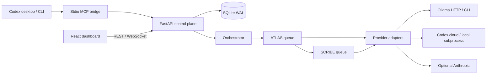

# G.E.R.A.L.D.

Global Execution, Routing, and Agent Lifecycle Director. A locally hosted workflow control plane with a React command deck, FastAPI runtime, persistent SQLite routing, streaming Ollama inference, and Codex desktop/CLI integration through MCP.


## Repository contents

The repository includes the complete backend, frontend source, dependency manifests and lockfiles, launcher scripts, tests, CI workflow, and verification reports. Installed dependencies (`.venv`, `node_modules`), compiled UI assets, runtime databases, agent workspace files, logs, and local environment files stay on the workstation and are ignored by Git. On another machine, run `scripts/setup.ps1` to install dependencies and build the dashboard, select an installed Ollama model, and run `scripts/connect-codex.ps1` to register that checkout's MCP bridge.

## File directory map

```text
gerald/
  .env.example                    All environment settings; no credentials included
  AGENTS.md                       Guidance for Codex working on this project
  README.md                       Setup, architecture and operating instructions
  VERIFICATION.json               Results from actual installed providers
  .github/workflows/ci.yml         Backend tests and frontend build
  backend/
    requirements.txt              Compatible dependency ranges
    requirements-lock.txt         Installed Windows Python dependency snapshot
    gerald/
      config.py                   Environment, server/model defaults and paths
      models.py                   Validated request schemas
      storage.py                  SQLite state and bounded event journal
      providers.py                Ollama HTTP/CLI, Codex cloud/local, Anthropic
      core.py                     BaseAgent, Orchestrator, queues, graph and lifecycle
      main.py                     REST API, WebSocket telemetry, compiled UI hosting
      mcp_bridge.py               Seven stdio tools for Codex desktop and CLI
  frontend/
    package.json / package-lock.json
    vite.config.ts                Local development API/WebSocket proxy
    postcss.config.js             Tailwind 4 compilation
    src/
      main.tsx                    React entry
      api.ts                      Typed data and API client
      App.tsx                     Matrix, worker forge, activity, missions, integrations
      style.css                   Obsidian/cyan/amber HUD, responsive layouts
    dist/                         Built dashboard, ready to serve
  scripts/
    setup.ps1                     Install dependencies and compile UI
    start.ps1                     Foreground localhost server; Ctrl+C shuts down workers
    start-background.ps1          Hidden background server with recorded PID
    stop.ps1                      Stop this project's managed background process tree
    connect-codex.ps1             Register stdio bridge in Codex
    verify-live.py                Real provider connectivity/generation checks
    verify-mcp.py                 Official MCP client protocol smoke test
    verify-workflow.py            Starter graph and real end-to-end mission test
  tests/
    test_core.py                  Routing, cycle rejection, controls and fallback tests
    test_api.py                   API validation, origin checks and WebSocket test
    test_processes.py             Actual CLI parent/child cleanup and local policy tests
  data/                           Created locally; ignored by Git
    gerald.sqlite3                Agent specs, graph, mode, missions and event journal
    workspace/                    Worker input files and generated artifacts
    server*.log / server.pid      Managed background server diagnostics
```

## Start on this machine

Dependencies and the compiled frontend are already installed. Open PowerShell in this folder:

```powershell
.\scripts\start.ps1
```

Open **http://127.0.0.1:8765**. If the server is already running, open the URL directly. The backend serves the compiled frontend and WebSocket connection from the same origin. No frontend dev server is required.

For a hidden background launch use `scripts/start-background.ps1`; stop that instance with `scripts/stop.ps1`. The delivered instance is already running in the background.

For a fresh install, use Node.js 22+ and Python 3.12+, then run:

```powershell
.\scripts\setup.ps1
.\scripts\connect-codex.ps1
.\scripts\start.ps1
```

The setup script detects the normal Python command or this machine's Python installation. The existing environment was created with the bundled Python 3.12 runtime. Python dependency ranges are portable; `requirements-lock.txt` records the installed Windows environment, including Windows-specific packages.

## Use the dashboard

1. **Forge new agent**: set a designation, role, directive, provider and model. Local model choices are discovered from your configured Ollama servers. Each new worker is initially connected to GERALD.
2. **Issue a directive**: select GERALD to plan and distribute a goal, or select a worker for direct execution. The orchestration plan is an explicit task list; the activity terminal shows public decisions, task lifecycle and outputs.
3. **Route work visually**: drag from a source handle to a target handle. Reconnect an edge to redirect it; select an edge and press Delete/Backspace to unlink it. The backend commits graph changes atomically and rejects cycles. Current work uses the latest graph when it completes.
4. **Pause** lets the current generation finish, then holds new tasks. **Resume** releases the queue. **Abort** cancels current execution and discards that agent's queued tasks. Other agents already executing remain independent. **Delete** aborts and removes the worker and its edges.
5. **Configure** edits a worker's directive, provider and tool permissions. Changes apply to its next generation. Dragged positions persist across server restarts.
6. **Select an active unit** to inspect its output. The mission archive shows completion, failures and pending counts. Host CPU/RAM and real generation throughput stream over WebSocket.

## Execution paths

| Dashboard brain | Execution path | Credentials |
| --- | --- | --- |
| Ollama HTTP | Streaming `/api/chat` on a configured server | None for local models |
| Ollama CLI | `ollama run MODEL --hidethinking --nowordwrap --verbose` | None for local models |
| Codex cloud | `codex exec --json --ephemeral` | Existing `codex login` ChatGPT session |
| Codex local | `codex exec --oss --local-provider ollama --json` | None for local models |
| Anthropic | Streaming Messages API | Optional server-side `ANTHROPIC_API_KEY` |

Your existing Ollama models remain installed. The HTTP default is `ornith-1.5:9b`. The tested Codex local default is `qwen2.5-coder:14b`; imported Ornith models failed Codex tool-schema generation during verification. The local Codex adapter disables browser/image/multi-agent tool families for compatibility with Ollama's tool schema parser. Its shell/file execution remains available under Codex's sandbox.

**Local mode** redirects cloud agents to local Ollama, requires loopback server addresses, and substitutes the default local model for `:cloud` names. It controls GERALD's provider selection; it does not change the operating system firewall or independently configured Ollama server networking. **Cloud mode** allows the chosen cloud providers. If a Codex-cloud or Anthropic call fails, that task retries using local Ollama. Mode changes apply when a task starts, and do not migrate an in-flight generation.

To add an Ollama server, copy `.env.example` to `.env`, edit `GERALD_OLLAMA_URLS` (comma-separated addresses), and restart. Remote servers work in cloud mode. Do not commit `.env`. No API keys are sent to the frontend. OpenAI cloud generation is provided by the installed Codex CLI and existing sign-in, so a separate OpenAI API key is not required.

## Codex desktop and CLI integration

The installed bridge uses Codex's shared MCP configuration. Run `scripts/connect-codex.ps1` if you move the project. Restart Codex after registration, keep GERALD running, then use these tools:

| Tool | Purpose |
| --- | --- |
| `gerald_state` | Inspect workers, graph, missions, outputs and events |
| `gerald_integrations` | Discover configured Ollama servers and installed CLIs |
| `gerald_forge` | Create a worker with a directive, brain and tools |
| `gerald_mission` | Submit a goal to GERALD or a specific worker |
| `gerald_control` | Pause, resume, abort or delete a worker |
| `gerald_route` | Replace graph edges atomically |
| `gerald_mode` | Toggle local/cloud execution |

Example instruction in a new Codex chat: “Use GERALD to inspect the agents, give ATLAS a short planning task, and report the resulting job status.” The bridge exposes the same local runtime to desktop and CLI; it does not scrape or modify unrelated desktop chats. Worker Codex subprocesses ignore the global user configuration to prevent recursive GERALD MCP invocation and accidental inheritance of unrelated plugins.

Verify registration and protocol:

```powershell
codex mcp get gerald
.\.venv\Scripts\python.exe scripts\verify-mcp.py
```

The implementation follows [Codex MCP documentation](https://developers.openai.com/codex/mcp), the installed `codex exec --help`, and [Ollama's Codex integration](https://docs.ollama.com/integrations/codex). Ollama streaming uses the [official chat API](https://docs.ollama.com/api/chat).

## Architecture and runtime behavior

Each BaseAgent owns a bounded asyncio queue and one worker task. The Orchestrator holds the mutable DAG, dispatches JSON task plans to directly connected workers, and forwards worker outputs down the latest edges. Invalid plans fall back to broadcasting the original goal to connected workers. Fan-out is supported; multiple upstream messages invoke a downstream agent independently rather than joining them into a single combined input. There is no autonomous infinite agent loop: the graph is acyclic and queues, output size and task duration are bounded.



Jobs count pending tasks across branches and become complete only after all scheduled work settles. A watchdog expires queued work, including paused queues, after `GERALD_TASK_TIMEOUT`. Provider calls have the same execution deadline. Mission history, specs, routing, node positions and public events persist in SQLite WAL. A server restart restores configuration and marks interrupted running missions; it does not replay unfinished tasks.

CLI workers run in Windows Job Objects with kill-on-close and explicit process tree cleanup on cancellation. HTTP workers cancel and close their streaming connections; the shared Ollama server is left running. A disconnected client cannot request additional work through that cancelled stream, but the server's handling of already submitted inference belongs to Ollama. The foreground launcher runs graceful FastAPI shutdown on Ctrl+C. The managed background stop script verifies the recorded PID's executable/command before terminating its tree.

HTTP agents share the backend process, so per-agent CPU/RAM attribution is unavailable. The HUD reports host metrics, actual CLI process RAM/CPU time where a PID exists, and provider generation throughput. Codex throughput is output tokens divided by end-to-end execution time; Ollama uses reported generation timing. The UI does not fabricate per-agent inference memory or GPU counters.

Utility permissions have concrete provider-specific behavior: `system_metrics` adds host telemetry to the task; `workspace_read` adds a bounded text snapshot for direct model providers; `workspace_write` saves their answer as a workspace artifact. Codex uses its built-in tools, with `workspace_write` selecting workspace-write instead of read-only sandboxing, and the workspace set as its working directory. Codex's sandbox policy controls its broader filesystem reads; these checkboxes do not provide a custom per-file OS isolation boundary. Model outputs are displayed as plain text.

This is a local single-user application, bound to loopback with Host and browser Origin validation. It has no multi-user authentication or remote exposure configuration. Local processes can access its API. Production deployment beyond this local operating model requires an explicit authentication and deployment design.

## API surface

`GET /api/health`, `GET /api/state`, `GET /api/integrations`; `POST /api/agents` and `PUT /api/agents/{id}` use AgentSpec (`name`, `role`, `directive`, `provider`, `model`, `server`, `tools`, `x`, `y`). `PATCH /api/agents/{id}/position` accepts `{x,y}`. `POST /api/agents/{id}/{pause|resume|abort|delete}` controls lifecycle. `PUT /api/graph` accepts `{edges:[{source,target}]}`. `POST /api/goals` accepts `{prompt,agent_id}` and returns a job ID. `PUT /api/mode` accepts `{mode:"local"|"cloud"}`. `/ws` streams public events and approximately one state/telemetry snapshot per second. Interactive API documentation is at `/docs`.

## Development and verification

```powershell
$env:PYTHONPATH='backend'
.\.venv\Scripts\python.exe -m pytest tests -q
Push-Location frontend
npm run build
npm audit
npm run dev
Pop-Location
```

The development UI runs on port 5173 and proxies to the backend on 8765. Build changes before returning to the compiled localhost dashboard. `GERALD_PORT` can change the production port; set it in the PowerShell environment before launching both the server and MCP bridge. For development with another backend port, update the Vite proxy too.

`scripts/verify-live.py` sends one tiny prompt through each installed execution path and saves `VERIFICATION.json`; it uses the Codex account for its cloud check. Anthropic is implemented but not live-tested unless you configure its optional credential. No model downloads or global model/provider changes are required.
